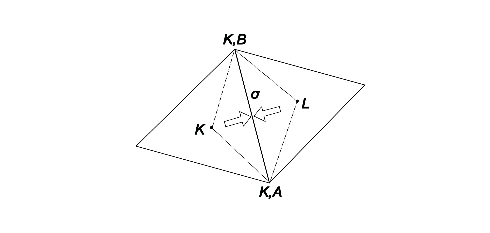

# Sayram 2D: Numerical Algorithm

**Author:** Xin Tao

*Converted from `docs/sayram2d_algorithm.tex`; equations are retained in LaTeX math notation.*

## The 2D diffusion equation to be solved
Sayram 2D aims to solve the 2D diffusion equation with a loss (or source term)
in the following form:
$$
\begin{aligned}
\frac{\partial f}{\partial t} = \frac{1}{G} \frac{\partial }{\partial Q_{i}}\left(G D_{Q_{i}Q_{j}}\frac{\partial f}{\partial Q_{j}}\right) - \frac{f}{\tau}.
\end{aligned}
\tag{1}
$$
Equivalently,
$$
\begin{aligned}
\frac{\partial f}{\partial t} = \frac{1}{G}\nabla \cdot(\Lambda \cdot \nabla f) - \frac{f}{\tau}.
\end{aligned}
\tag{2}
$$
where 
$$
\begin{aligned}
\Lambda = \begin{bmatrix}
    GD_{Q_1Q_1} & GD_{Q_1Q_2} \\
    GD_{Q_1Q_2} & GD_{Q_2Q_2}
  \end{bmatrix}
\end{aligned}
\tag{3}
$$
is the diffusion tensor. The equation is subject to the following Dirichlet
($\Gamma_{D}$) and Neumann ($\Gamma_{N}$) boundary conditions:
$$
\begin{aligned}
f &= g_{D}, \quad \text{on } \Gamma_{D}, \\ 
  q_{N} &= \boldsymbol{n}\cdot \left(-\Lambda \cdot \nabla f\right), \quad \text{on } \Gamma_{N}.
\end{aligned}
\tag{4}
$$
The $q_{N}$ is the flux satisfying $q_{N} \leq 0$. Here $G > 0$ is the
Jacobian of the coordinate transformation, the $D_{Q_{i}Q_{j}}$ are diffusion
coefficients that may depend on time, and $\tau$ characterizes loss or
source. The $f/\tau$ term can be easily handled, and we will mainly deal with
the negative solution problem caused by the mixed diffusion coefficients using a
positivity-preserving finite volume method of Gao and Wu (2015).

## A positivity-preserving finite volume method
The PPFV method was developed by Gao and Wu (2015) and is reviewed here. Denoting the value of $f$ at cell $K$ as $f_{K}$, the basic principle of constructing the PPFV method is to write the equation to obtain $f_{K}(t+\Delta t)$ from $f(t)$ as follows:
$$
\begin{aligned}
f_K(t+\Delta t) = \sum_{i}\alpha_i f_{K, i}(t),
\end{aligned}
\tag{5}
$$
where $f_{K,i}$ is the value of $f$ of the $i_{\text{th}}$ cell that contributes to updating the value of $f_{K}$. Note that this summation may also include $f_{K}$ itself. If all coefficients ($\alpha_{i}$'s) satisfy $\alpha_i \ge 0 $, and $f_{K,i}(t) \geq 0$, then the above equation guarantees that $f_{K}(t+\Delta t) \geq 0$. Clearly, for the radiation belt diffusion problem, the initial phase space density for every cell is non-negative. This illustrates the positivity principle; the method below achieves it through an $M$-matrix.

**Figure 1.** Illustration of the Nonlinear Two-Point Flux Approximation (NTPFA). We first construct a one-sided flux, from cell center $K$ to edge $\sigma$, using only values of $f_K$, $f_{K,A}$, $f_{K,B}$. This process is then repeated for the cell $L$. The flux used in the PPFV method to update $f_{K}$ or $f_{L}$ is derived using the one-sided fluxes.

We consider the diffusion equation part of Equation (2): 
$$
\begin{aligned}
G\frac{\partial f}{\partial t} = \nabla \cdot(\Lambda \nabla f),
\end{aligned}
\tag{6}
$$
Integrating the above equation over a cell $K$, we have
$$
\begin{aligned}
\int_{K} G \frac{\partial f}{\partial t} \mathrm{d} V  = \oint_{\partial K} \Lambda \nabla f \cdot \mathrm{d} \boldsymbol{A} \approx - \sum_{\sigma} \tilde{J}_{K,\sigma},
\end{aligned}
\tag{7}
$$
where the summation is over all edges of the cell $K$. In the following, we demonstrate the construction of $\tilde{J}_{K,\sigma}$ based on the idea of NTPFA and Gao and Wu (2015), ensuring the positivity of $f$.

Consider cell $K$, as illustrated by Figure 1. Gao and Wu (2015) first constructed the one-sided flux from cell center $K$ to the edge $\sigma$ of the following form:
$$
\begin{aligned}
J_{K,\sigma} &= \alpha_{K,\sigma, A}(f_K - f_{K,A}) + \alpha_{K,\sigma, B}(f_K - f_{K,B}) \\
                 &= (\alpha_{K,\sigma,A} + \alpha_{K,\sigma,B}) f_{K} - (\alpha_{K,\sigma,A} f_{K,A} + \alpha_{K,\sigma,B} f_{K,B}),
\end{aligned}
\tag{8}
$$
where $\alpha_{K,\sigma, A}$ and $\alpha_{K,\sigma, B}$ represent the coefficients to be determined. This $J_{K,\sigma}$ approximates 
$$
\begin{aligned}
-\int_{\sigma} (\Lambda \cdot \nabla f) \cdot \boldsymbol{n}_{K,\sigma}
    \mathrm{d} s
\end{aligned}
\tag{9}
$$
using information from cell $K$ only.

Gao and Wu (2015) demonstrate that, to ensure the final scheme is positivity-preserving, the only condition required is that for every cell such as $K$, the coefficients satisfy the condition 
  $$
\begin{aligned}
\alpha_{K,\sigma, A} + \alpha_{K,\sigma, B} > 0.
\end{aligned}
\tag{10}
$$
Gao and Wu (2015) proposed the following expressions for the coefficients,  
  $$
\begin{aligned}
\alpha_{K,\sigma, A} = |\sigma|\frac{\boldsymbol{n}_{K,\sigma}^T\Lambda_K\mathcal{R}(\boldsymbol{x}_{K,B} - \boldsymbol{x}_K)}{(\boldsymbol{x}_{K,A} - \boldsymbol{x}_K)^T\mathcal{R}(\boldsymbol{x}_{K,B} - \boldsymbol{x}_K)}, \\
    
    \alpha_{K,\sigma, B} = |\sigma|\frac{\boldsymbol{n}_{K,\sigma}^T\Lambda_K\mathcal{R}(\boldsymbol{x}_{K,A} - \boldsymbol{x}_K)}{(\boldsymbol{x}_{K,B} - \boldsymbol{x}_K)^T\mathcal{R}(\boldsymbol{x}_{K,A} - \boldsymbol{x}_K)}.
\end{aligned}
\tag{11}
$$
Here $|\sigma|$ represents the length of the edge $\sigma$,
$\boldsymbol{n}_{K,\sigma}$ is the outer unit column vector normal to $\sigma$
from center cell $K$, and $\Lambda_K$ is the diffusion coefficient matrix
evaluated at the cell center $K$. The superscript $T$ denotes the transpose of a
vector or matrix. Column vectors $\boldsymbol{x}_{K}, \boldsymbol{x}_{K,A}$, and
$\boldsymbol{x}_{K,B}$ represent the coordinates of the cell center, and
vertices $(K,A)$ and $(K,B)$, respectively. Operator $\mathcal{R}$ denotes a
clockwise rotation by $\pi/2$. The idea of this construction approach can be
summarized as making a geometric vector decomposition on $\boldsymbol{x}_{K,B} - \boldsymbol{x}_K$ and $\boldsymbol{x}_{K,A} - \boldsymbol{x}_K$ in $\Lambda_K$ space (Lipnikov et al., 2007; Wu and Gao, 2014). The sum of $\alpha_{K,\sigma, A}$ and $\alpha_{K,\sigma, B}$ can be shown to be (Gao and Wu, 2015)
  $$
\begin{aligned}
\alpha_{K,\sigma, A} + \alpha_{K,\sigma, B} = |\sigma| \frac{\boldsymbol{n}_{K,\sigma}^T\Lambda_K\mathcal{R}(\boldsymbol{x}_{K,B} - \boldsymbol{x}_{K,A})}{(\boldsymbol{x}_{K,A} - \boldsymbol{x}_K)^T\mathcal{R}(\boldsymbol{x}_{K,B} - \boldsymbol{x}_K)} = \frac{|\sigma|}{d_{K,\sigma}}\boldsymbol{n}_{K,\sigma}^T\Lambda_K\boldsymbol{n}_{K,\sigma},
\end{aligned}
\tag{12}
$$
where $d_{K, \sigma}$ represents the distance from point $K$ to edge $\sigma$. Since the diffusion tensor $\Lambda_K$ is required to be positive definite, the condition (10) on coefficients $\alpha_{K,\sigma,A}$ and $\alpha_{K,\sigma,B}$ is satisfied. Similarly, the one-sided flux, $J_{L,\sigma}$, is constructed as
  $$
\begin{aligned}
J_{L,\sigma} = \alpha_{L,\sigma, A}(f_L - f_{L,A}) + \alpha_{L,\sigma, B}(f_L - f_{L,B}).
\end{aligned}
\tag{13}
$$
The coefficients $\alpha_{L,\sigma,A}$ and $\alpha_{L,\sigma,B}$ are calculated using the same coefficient expressions.

The total flux from cell $K$ to cell $L$ through the edge $\sigma$, $\tilde{J}_{K,\sigma}$, is then expressed as a linear combination of $J_{K,\sigma}$ and $J_{L,\sigma}$; i.e., 
  $$
\begin{aligned}
&\tilde{J}_{K,\sigma} = \mu_{K,\sigma}J_{K,\sigma} - \mu_{L,\sigma}J_{L,\sigma}, \\
          &\mu_{K,\sigma} + \mu_{L,\sigma} = 1,
\end{aligned}
\tag{14}
$$
where $\mu_{K,\sigma}$ and $\mu_{L,\sigma}$ are two coefficients to be provided below. As discussed above, $\tilde{J}_{K,\sigma}$ is the flux used to update $f_{K}$ or $f_{L}$ in the finite volume method. To satisfy the local conservation property of finite volume methods, the flux from cell $L$ to cell $K$ through $\sigma$, $\tilde{J}_{L,\sigma}$, is then
  $$
\begin{aligned}
\tilde{J}_{L,\sigma} = \mu_{L,\sigma}J_{L,\sigma} - \mu_{K,\sigma}J_{K,\sigma},
\end{aligned}
\tag{15}
$$
so that $\tilde{J}_{K,\sigma} + \tilde{J}_{L,\sigma} = 0$.

Based on the NTPFA idea and equations for the one-sided fluxes (8) and (13), we define two new coefficients 
  $$
\begin{aligned}
&a_{K,\sigma} = \alpha_{K,\sigma,A}f_{K,A}^{t} + \alpha_{K,\sigma,B}f_{K,B}^{t}, \\
          &a_{L,\sigma} = \alpha_{L,\sigma,A}f_{L,A}^{t} + \alpha_{L,\sigma,B}f_{L,B}^{t}.
\end{aligned}
\tag{16}
$$
Here $f_{K,A}^t$ and $f_{K,B}^t$ are obtained by bilinear interpolation
from the four surrounding cell-centered values at time $t$, since we use
orthogonal rectangular meshes. Then we choose $\mu_{K,\sigma}$ and $\mu_{L,\sigma}$ to be
  $$
\begin{aligned}
\mu_{K,\sigma} = \begin{cases}
      0.5 & a_{K,\sigma} = a_{L,\sigma} = 0, \\
      \displaystyle \frac{|a_{L,\sigma}|}{|a_{K,\sigma}| + |a_{L,\sigma}|} & \text{otherwise},
    \end{cases}
\end{aligned}
\tag{17}
$$
and $\mu_{L,\sigma} = 1 - \mu_{K,\sigma}$. Set 
  $$
\begin{aligned}
B_{\sigma} = \begin{cases}
      \mu_{L,\sigma}a_{L,\sigma} - \mu_{K,\sigma}a_{K,\sigma} & \sigma \in \text{inner cell edges}; \quad \sigma \in \mathcal{C}_{K} \cap \mathcal{C}_{L} \\
      -a_{K,\sigma} & \sigma \in \text{Dirichlet boundaries}; \quad \sigma \in \mathcal{C}_{K} \cap \Gamma_{D}.
    \end{cases}
\end{aligned}
\tag{18}
$$
and 
  $$
\begin{aligned}
&B_{\sigma}^+=\frac{|B_{\sigma}| + B_{\sigma}}{2}, \\
    &B_{\sigma}^-=\frac{|B_{\sigma}| - B_{\sigma}}{2},
\end{aligned}
\tag{19}
$$
then, using coefficients evaluated at time $t$, we approximate the flux in
Equation (14) at time $t+\Delta t$ as
  $$
\begin{aligned}
\tilde{J}_{K,\sigma} = A_{K,\sigma} f_K^{t+\Delta t} - A_{L,\sigma} f_L^{t+\Delta t} + B_{\sigma}^{\epsilon},
\end{aligned}
\tag{20}
$$
where
  $$
\begin{aligned}
&A_{K,\sigma}(f) = \mu_{K,\sigma}(\alpha_{K,\sigma,A} + \alpha_{K,\sigma,B}) + \frac{B_{\sigma}^+}{f_K^{t} + \epsilon}, \\
    &A_{L,\sigma}(f) = \mu_{L,\sigma}(\alpha_{L,\sigma,A} + \alpha_{L,\sigma,B}) + \frac{B_{\sigma}^-}{f_L^{t} + \epsilon}, \\
    &B_{\sigma}^{\epsilon} = \frac{B_{\sigma}^+\epsilon}{f_K^{t} + \epsilon} - \frac{B_{\sigma}^-\epsilon}{f_L^{t} + \epsilon}.
\end{aligned}
\tag{21}
$$
Here $\epsilon$ denotes a small positive number, typically near machine precision. The important thing to note here is that $A_{K,\sigma}$ and $A_{L,\sigma}$ are positive by construction. This property will be used below to prove the positivity preservation of the new method. The term $B_{\sigma}^{\epsilon}$ is neglected following Gao and Wu (2015);
it vanishes when $a_{K,\sigma}a_{L,\sigma}\geq 0$, but otherwise its
neglect may affect accuracy. Thus, we obtain
  $$
\begin{aligned}
\tilde{J}_{K,\sigma} = A_{K,\sigma} f_K^{t+\Delta t} - A_{L,\sigma}f_L^{t+\Delta t},
\end{aligned}
\tag{22}
$$
and $\tilde{J}_{L,\sigma} = -\tilde{J}_{K,\sigma}$. 

When dealing with an edge subject to the Dirichlet boundary condition, we directly use the one-sided flux as $\tilde{J}_{K,\sigma}$; i.e.,  
  $$
\begin{aligned}
\tilde{J}_{K,\sigma_{D}} = J_{K,\sigma_{D}} = (\alpha_{K,\sigma,A} + \alpha_{K,\sigma,B})f_K^{t+\Delta t} + B_{\sigma}^+ - B_{\sigma}^-.
\end{aligned}
\tag{23}
$$
  This can be written as 
  $$
\begin{aligned}
\tilde{J}_{K,\sigma_{D}} \approx \left(\alpha_{K,\sigma_{D},A} + \alpha_{K,\sigma_{D},B} + \frac{B_{\sigma}^{+}}{f_{K}^{t}+\epsilon}\right) f_K^{t+\Delta t} - B_{\sigma}^-.
\end{aligned}
\tag{24}
$$
  Clearly, the coefficient is just $A_{K, \sigma_D}$ with $\mu_{K,\sigma}=1$. 

When dealing with Neumann boundary conditions, $\sigma_{N}$, we directly use the
flux:
$$
\begin{aligned}
\tilde{J}_{K,\sigma_{N}} \approx |\sigma_{N}| q_{N}.
\end{aligned}
\tag{25}
$$

Next, we focus on the $K_{\text{th}}$ cell of the simulation domain and apply the above flux estimate to Equation (6).   
$$
\begin{aligned}
G_{K} \frac{\Delta C_{K}}{\Delta t} (f^{t+\Delta t}_{K} - f^{t}_{K}) = -\sum\limits_{\sigma} \tilde{J}_{K,\sigma} - \sum_{\sigma_{D}} \tilde{J}_{K,\sigma_{D}} - \sum_{\sigma_{N}}\tilde{J}_{K,\sigma_{N}}.
\end{aligned}
\tag{26}
$$
The summation is over all edges of the cell. Substituting the above forms
for the flux, we have 
$$
\begin{aligned}
G_{K} \frac{\Delta C_{K}}{\Delta t} (f^{t+\Delta t}_{K} - f^{t}_{K}) = &{}-\sum_{\sigma} \left(A_{K,\sigma} f^{t+\Delta t}_{K} - A_{L,\sigma} f^{t+\Delta t}_{L,\sigma}\right)  \\
  &- \left(\sum_{\sigma_{D}}A_{K,\sigma_{D}}\right) f_{K}^{t+\Delta t} + \sum_{\sigma_{D}} B_{\sigma_{D}}^{-} - \sum_{\sigma_{N}} \left[|\sigma_{N}| q_{N}\right].
\end{aligned}
\tag{27}
$$
Note that $q_{N} \leq 0$.

Denoting $U_{KK} = G_{K} \Delta C_{K} / \Delta t$, the above equation can be further reorganized as 
$$
\begin{aligned}
&\left(U_{KK} + \sum_{\sigma} A_{K,\sigma} + \sum_{\sigma_{D}} A_{K,\sigma_{D}} \right) f_{K}^{t+\Delta t} - \sum_{\sigma} A_{L,\sigma} f_{L,\sigma}^{t+\Delta t} \\
   & = U_{KK} f_{K}^{t} + \sum_{\sigma_{D}} B_{\sigma_{D}}^{-} - \sum_{\sigma_{N}} \left[|\sigma_{N}| q_{N}\right].
\end{aligned}
\tag{28}
$$

Rewriting the above equation as
  $$
\begin{aligned}
\mathsf{M} \boldsymbol{f}^{t+\Delta t} = \boldsymbol{R}.
\end{aligned}
\tag{29}
$$
Then
$$
\begin{aligned}
R_{K} = U_{KK} f_{K}^{t} + \sum_{\sigma_{D}} B_{\sigma_{D}}^{-} - \sum_{\sigma_{N}} \left[|\sigma_{N}| q_{N}\right].
\end{aligned}
\tag{30}
$$
and
$$
\begin{aligned}
M_{KK} &= U_{KK} + \sum_{\sigma} A_{K,\sigma} + \sum_{\sigma_{D}} A_{K,\sigma_{D}}, \\
  M_{KL} &= -A_{L,\sigma}.
\end{aligned}
\tag{31}
$$
Here $L$ is the neighboring cell sharing the edge $\sigma$ with $K$.

By construction, $R_{K} \geq 0$, and $\mathsf{M}$ has the following properties
$M_{KK} > 0$, $M_{KL} \le 0$, and the summation along the $K_{\text{th}}$ column
is positive; i.e., 
  $$
\begin{aligned}
\sum_{L} M_{LK} > 0.
\end{aligned}
\tag{32}
$$
To see this, note that the off-diagonal contributions cancel the interior-edge terms; therefore, 
  $$
\begin{aligned}
\sum_{L} M_{LK} = U_{KK} + \sum_{\sigma_{D}} A_{K,\sigma_{D}} > 0.
\end{aligned}
\tag{33}
$$
These properties make $\mathsf{M}$ a nonsingular $M$-matrix; i.e.,
$\mathsf{M}^{-1}$ is non-negative. Correspondingly, 
  $$
\begin{aligned}
\boldsymbol{f}^{t+\Delta t} = \mathsf{M}^{-1} \cdot \boldsymbol{R}  \geq 0.
\end{aligned}
\tag{34}
$$
Therefore, the constructed finite volume method is positivity-preserving.

The term $-f/\tau$ can represent either a loss ($\tau_K>0$) or a source
($\tau_K<0$). To preserve positivity, we treat losses implicitly and sources
explicitly (thanks to Bernard Hass at GFZ for pointing out that the original
operator splitting approach may become inaccurate if $\Delta t$ is large). For $\tau_K>0$, the loss contribution is
$$
\begin{aligned}
-G_K\Delta C_K\frac{f_K^{t+\Delta t}}{\tau_K},
\end{aligned}
\tag{35}
$$
so the diagonal entry becomes
$$
\begin{aligned}
M_{KK} &= U_{KK} + \sum_{\sigma} A_{K,\sigma} + \sum_{\sigma_D} A_{K,\sigma_D}
  + G_K\frac{\Delta C_K}{\tau_K} \\
  &= U_{KK}\left(1+\frac{\Delta t}{\tau_K}\right)
  + \sum_{\sigma} A_{K,\sigma} + \sum_{\sigma_D} A_{K,\sigma_D}.
\end{aligned}
\tag{36}
$$
For $\tau_K<0$, the source contribution is instead added to the right-hand side:
$$
\begin{aligned}
R_K \longrightarrow R_K + G_K\Delta C_K\frac{f_K^t}{|\tau_K|}.
\end{aligned}
\tag{37}
$$
Both treatments preserve the nonnegative right-hand side and the
$M$-matrix property, so the method remains positivity-preserving.

## References

- **Gao, Z., and J. Wu (2015).** A second-order positivity-preserving finite volume scheme for diffusion equations on general meshes. *SIAM Journal on Scientific Computing*, 37(1), A420–A438. https://doi.org/10.1137/140972470
- **Lipnikov, K., M. Shashkov, D. Svyatskiy, and Y. Vassilevski (2007).** Monotone finite volume schemes for diffusion equations on unstructured triangular and shape-regular polygonal meshes. *Journal of Computational Physics*, 227(1), 492–512. https://doi.org/10.1016/j.jcp.2007.08.008
- **Wu, J., and Z. Gao (2014).** Interpolation-based second-order monotone finite volume schemes for anisotropic diffusion equations on general grids. *Journal of Computational Physics*, 275, 569–588. https://doi.org/10.1016/j.jcp.2014.07.011
